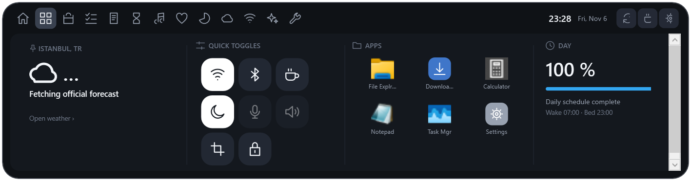
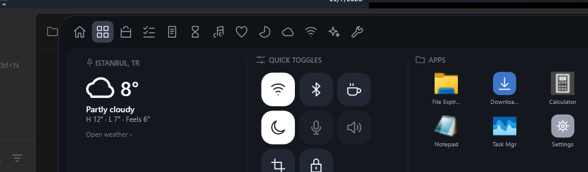

# Aether Island — Portable V2

A reference-driven floating productivity island for Windows 10/11 (x64).
Compact pill on top of your desktop; a click expands it into one dense dark
panel with: dashboard (live weather, real quick toggles, app launcher, day
progress), screen time with categories, now-playing + calendar, camera
mirror, file shelf, tasks with reminders, notes, focus timers, wellbeing,
weather detail, Wi-Fi/Bluetooth, utilities and full settings — all
local-first, no telemetry.




## Highlights

- **Reference-faithful UI** — layout, palette, toggles, widgets and module
  set match the supplied reference photos/video; every module rendered for
  evidence in `docs/screenshots/`.
- **Real integrations, no fake toggles** — Wi-Fi/Bluetooth radios
  (`Windows.Devices.Radios`), audio mute (endpoint API), dark mode,
  keep-awake, screenshot → clipboard, lock, SMTC media, Open-Meteo weather
  with IP auto-location, WLAN scan (honest about Windows' Location
  permission), Bluetooth devices.
- **Portable & installed** — self-contained ZIP (no runtime, no admin) and
  a per-user Inno Setup installer with a clean uninstaller that preserves
  your `Data\` folder by default.
- **Starts with Windows** — optional, standard per-user Run key that
  self-heals when the folder moves.
- **Light on resources** — measured 0.00% idle CPU over 60 s; event-driven
  updates; no polling loops (see docs/FINAL_ACCEPTANCE_REPORT.md).

## Get it

| Artifact | Where |
|---|---|
| Portable ZIP + SHA-256 | `release/portable-v2/` or CI artifact `AetherIsland-Portable-V2-win-x64` |
| Installer + SHA-256 | `release/` or CI artifact `AetherIsland-Setup-win-x64` |

Extract/Install → run `AetherIsland.exe`. Details:
docs/INSTALLATION.md · docs/MANUAL_INSTALL.md · docs/PORTABLE_USAGE.md.

## Build

```powershell
dotnet build AetherIsland.slnx -c Release
dotnet test AetherIsland.slnx
./tools/publish-portable-v2.ps1        # portable ZIP + SHA-256
./tools/package-installer.ps1          # Inno Setup installer (+ publish)
```

CI builds, tests, runs the live WPF self-check, captures every module view,
packages both artifacts and uploads them (`.github/workflows/windows-release.yml`).

## Documentation

- docs/ARCHITECTURE.md · docs/IMPLEMENTATION_AUDIT.md ·
  docs/REFERENCE_FIDELITY_MATRIX.md · docs/FEATURE_COVERAGE.md
- docs/INSTALLATION.md · docs/MANUAL_INSTALL.md · docs/PORTABLE_USAGE.md
- docs/KNOWN_LIMITATIONS.md ·
  docs/FINAL_ACCEPTANCE_REPORT.md

## Modules

Home · Dashboard (weather / quick toggles / apps / day) · File shelf · Tasks ·
Notes · Focus · Media + Calendar (+ Mirror) · Wellbeing · Screen time ·
Weather · Network · Utilities — plus Settings (gear) and tray
menu (Open, Refresh, Settings, Launch at startup, Reset position, Exit).

Keyboard: `Ctrl+Alt+Space` toggles the island · `Esc` collapses · drag the
header or pill to move.

## Privacy

Screen-time tracking is off by default and opt-in; it stores app names and
coarse seconds locally (never titles, URLs or keystrokes). API keys are
DPAPI-encrypted for the current Windows user. No telemetry.
